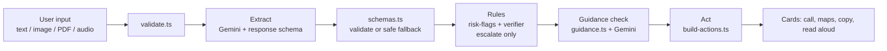

# Sankat Setu

[](https://github.com/Rahil-Mokashi/prompt-wars/actions/workflows/ci.yml)

An emergency bridge for India: messy input (text, photos, PDFs, audio) goes in, verified and prioritised
actions you can tap come out. **Live:** https://promptwars-rahil.web.app

## Problem alignment

Challenge: _build an original, functional AI-enabled application or agentic AI system that solves a
meaningful real-world problem through intelligent reasoning, automation, data-driven decisions and
reliable software engineering._

Sankat Setu is an AI pipeline that reasons and acts, not a chatbot. There is no chat interface.

| Step        | What happens                                                                                  | Code                                          |
| ----------- | --------------------------------------------------------------------------------------------- | --------------------------------------------- |
| **Input**   | Text plus up to 5 images, PDFs or audio files; validated; images downscaled in the browser    | `src/utils/validate.ts`, `src/utils/image.ts` |
| **Extract** | One Gemini call with a response schema; output validated; safe "Call 112" fallback on failure | `src/ai/extract.ts`, `src/ai/schemas.ts`      |
| **Verify**  | Deterministic escalate-only rules, then a check of first-aid actions against curated guidance | `src/domain/`, `src/ai/verify.ts`             |
| **Act**     | Call 112 / 108, Google Maps link to the nearest hospital, copy a hospital handoff, read aloud | `src/actions/`, `src/ui/render.ts`            |

## Evaluation checklist

| Criterion         | Where                                                                                                        |
| ----------------- | ------------------------------------------------------------------------------------------------------------ |
| Code quality      | Strict TypeScript, ESLint, Prettier, small pure functions: `src/domain/`, `src/actions/`                     |
| Security          | `firebase.json` (headers), `src/utils/validate.ts`, `src/ai/prompts.ts`, `SECURITY.md`                       |
| Efficiency        | One extraction call, browser-side image downscale, text cache, mock code excluded from the production bundle |
| Testing           | `tests/unit/` (Vitest), `tests/e2e/app.spec.ts` (Playwright + axe)                                           |
| Accessibility     | Landmarks, skip link, live region, `role="alert"`, 48px targets, axe test with zero violations               |
| Problem alignment | Section above                                                                                                |
| Google technology | Table below                                                                                                  |
| Performance       | `docs/lighthouse.md`, latency shown in the UI per call                                                       |

## Architecture



## Google services used

| Service                                       | Where                            | Why                                                       |
| --------------------------------------------- | -------------------------------- | --------------------------------------------------------- |
| Firebase AI Logic (Gemini Developer API)      | `src/firebase.ts`, `src/ai/*.ts` | Calls Gemini from the browser without shipping an API key |
| Gemini models (`gemini-3.5-flash-lite` first) | `src/config.ts` (`MODEL_CHAIN`)  | Structured extraction and guidance check                  |
| Firebase App Check (reCAPTCHA Enterprise)     | `src/firebase.ts`                | Only genuine app traffic can call the AI backend          |
| Firebase Hosting                              | `firebase.json`                  | Serves the app with security headers                      |
| Google Search grounding                       | `src/ai/verify.ts`               | Tried at most once per session; blocked on the free tier  |
| Google Maps (link only)                       | `src/actions/links.ts`           | Opens a nearest-hospital search                           |

## How verification works

1. **Rules** (`src/domain/risk-flags.ts`, `src/domain/verifier.ts`) are plain TypeScript. They may only
   escalate: raise severity, add "Call 112", or mark an action as needing a human check. They never lower
   severity or remove a safety action.
2. **Guidance check** (`src/ai/verify.ts`): first-aid actions are compared with 10 curated rules in
   `src/domain/guidance.ts`, written in our own words, each linked to the official site of WHO, Indian
   Red Cross, NDMA or MoHFW. Verdicts: supported, not_supported, not_covered.
3. **Grounding** is switched off (`GROUNDING_ENABLED = false` in `src/config.ts`) because Google Search
   grounding is blocked on the free tier. The code path and its tests are kept; when enabled it is tried once
   per session on the first model only, and a block (429/401/403) is remembered. The UI says "Web verified" only if grounding ran; otherwise
   "Checked against built-in guidance".

Every action shows `Verified` or `Needs human check`, with reasons and sources.

## Security, accessibility, efficiency, testing

- **Security:** see `SECURITY.md`. CSP and four other headers are set once each in `firebase.json`.
- **Accessibility:** ERSS 112 accepts SMS, so users who can't speak can text it (source: [Kerala Police ERSS page](https://wayanad.keralapolice.gov.in/page/erss)); the always-visible "Can't speak on a call?" section offers a prefilled "Text 112" link and an "Alert someone you trust" share button. Lighthouse accessibility 100; the Playwright test runs axe (WCAG 2.2 AA tags) and
  asserts zero violations.
- **Efficiency:** one extraction call; verification only on first-aid actions; images downscaled to 1600px
  JPEG 0.8; identical text input is cached; the mock code is not in the production bundle.
- **Testing:** 111 unit tests, 98.22% line coverage (96.88% statements, 91.85% branches) across all of
  `src/` except the browser-only entry points (`main.ts`, `firebase.ts`, `utils/image.ts`, `ai/mock.ts`),
  which the Playwright test exercises. The threshold is 80% lines, enforced in `vite.config.ts`. Gemini is
  mocked, so there is no network in unit tests. No triage-accuracy evaluation has been run, so no accuracy
  figure is claimed.
- **CI:** `.github/workflows/ci.yml` runs on every push to `main`: lint, typecheck, unit tests with
  coverage and build in one job, and the Playwright + axe test in a second job.
- **Code quality:** strict type-aware ESLint (`typescript-eslint` strict + stylistic), `complexity` at 10,
  `max-lines-per-function` at 50, no `any`, Prettier with LF line endings.

## Performance

Measured, not claimed:

- Lighthouse (mobile, live URL): Performance 94, Accessibility 100, Best Practices 100, SEO 100.
  FCP 2.5 s, LCP 2.5 s, TBT 0 ms, CLS 0. Details in `docs/lighthouse.md`.
- Bundle: JS 92.76 kB (30.60 kB gzip), CSS 2.88 kB (1.17 kB gzip).
- One measured live run (text + PDF, gemini-3.5-flash-lite): extract 5.7 s, verify 2.1 s.
- Analyse latency: shown in the UI after every run (extract and verify time, and the model used). No
  median over repeated live runs has been recorded yet.

## Disclosure

- **Libraries:** firebase (app, app-check, ai), Vite, TypeScript, Vitest, jsdom, @vitest/coverage-v8,
  ESLint, typescript-eslint, Prettier, Playwright, @axe-core/playwright. Lighthouse was used once to
  measure.
- **Models and APIs:** Gemini models through Firebase AI Logic (Gemini Developer API); Google Search
  grounding attempt; Google Maps search links.
- **Services:** Firebase Hosting, Firebase App Check with reCAPTCHA Enterprise.
- **AI coding tools:** built with Claude Code.
- Original code throughout; guidance rules are written by us and link to official organisation sites.

## Project structure

```
src/
  main.ts              wires the page to the pipeline (DOM lookups, events, cache)
  config.ts            every constant: models, limits, timeouts, emergency numbers
  firebase.ts          Firebase app, App Check, AI Logic client
  ai/                  extract.ts, verify.ts, gemini.ts (model factory), model-fallback.ts,
                       prompts.ts, schemas.ts (schemas + validators), mock.ts (dev only)
  domain/              pure rules: types, verifier, risk-flags, guidance, packs/
  actions/             pure builders: action cards, ER summary, tel/Maps/SMS links
  ui/                  render.ts (DOM, textContent only), a11y.ts, i18n.ts (UI strings)
  utils/               validate.ts, image.ts
tests/unit/            Vitest, Gemini mocked
tests/e2e/             Playwright + axe
docs/lighthouse.md     measured Lighthouse results
```

## Setup, test, deploy

```bash
npm install
cp .env.example .env.local        # fill in the public Firebase web config and reCAPTCHA site key
echo VITE_USE_MOCK=true > .env.development.local   # optional: canned responses, dev server only
npm run dev
```

| Script              | Purpose                                        |
| ------------------- | ---------------------------------------------- |
| `npm run dev`       | Vite dev server                                |
| `npm run lint`      | ESLint (type-aware, strict) and Prettier check |
| `npm run typecheck` | `tsc --noEmit`                                 |
| `npm test`          | Vitest with coverage (80% lines threshold)     |
| `npm run build`     | Typecheck and production build to `dist/`      |
| `npm run e2e`       | Playwright + axe, uses mock mode               |

Deploy with `firebase deploy --only hosting`. On localhost, App Check uses a debug token printed in the
browser console; register it in the Firebase console. It is never committed.

## Limitations and disclaimer

- English only. The disaster pack, Hindi/Marathi, QR handoff, voice recording, analytics and Remote Config
  are not implemented.
- Google Search grounding is blocked on the free tier, so verification normally uses built-in guidance.
- Guidance covers 10 topics; anything else is marked "Needs human check".
- Sankat Setu gives first steps only. It does not diagnose, never advises stopping prescribed medicine, and
  is not a substitute for a doctor. In an emergency always call 112.
